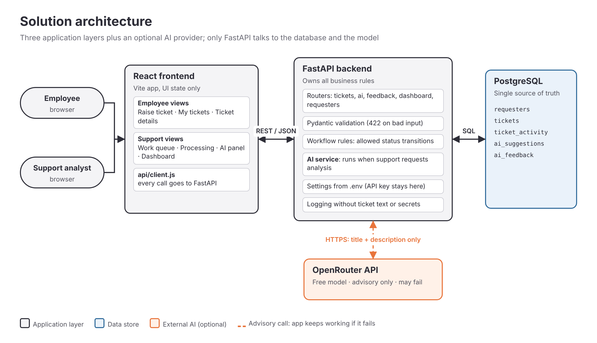
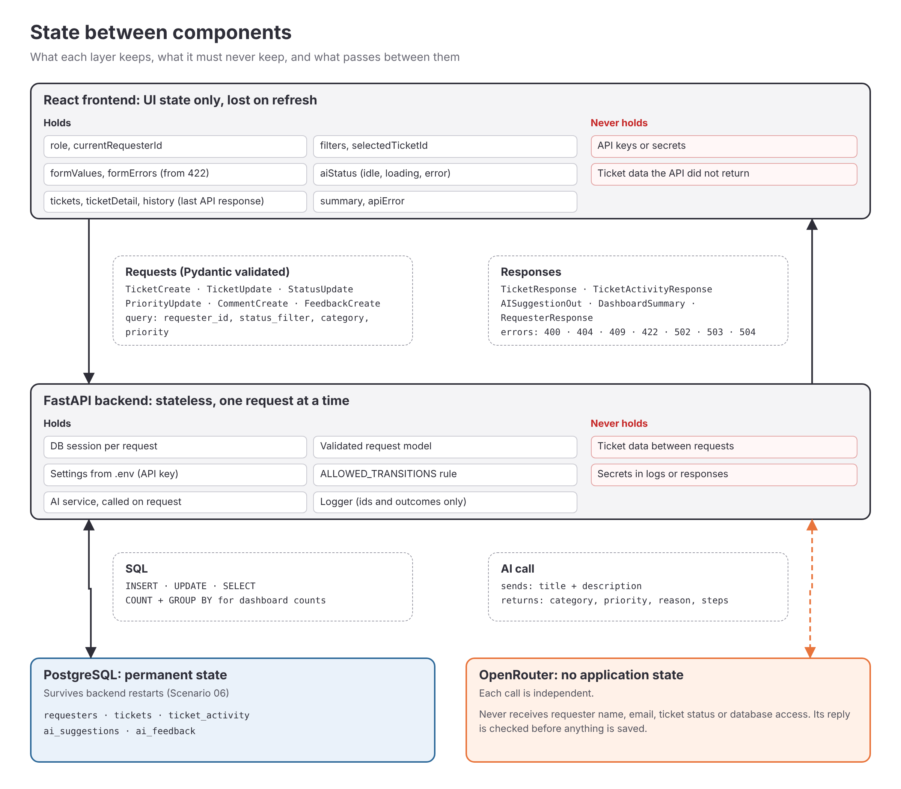
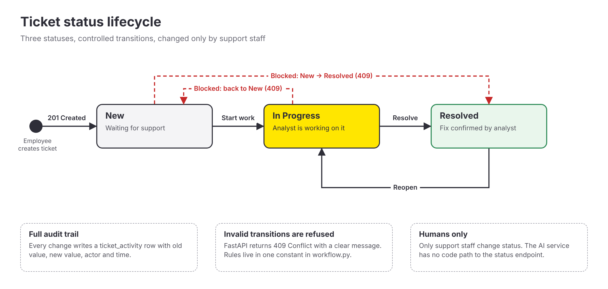
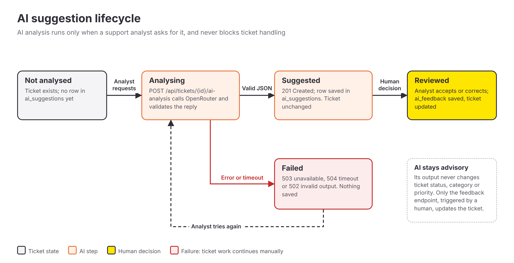
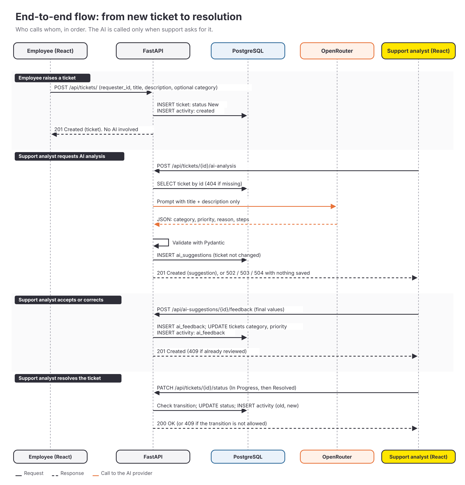
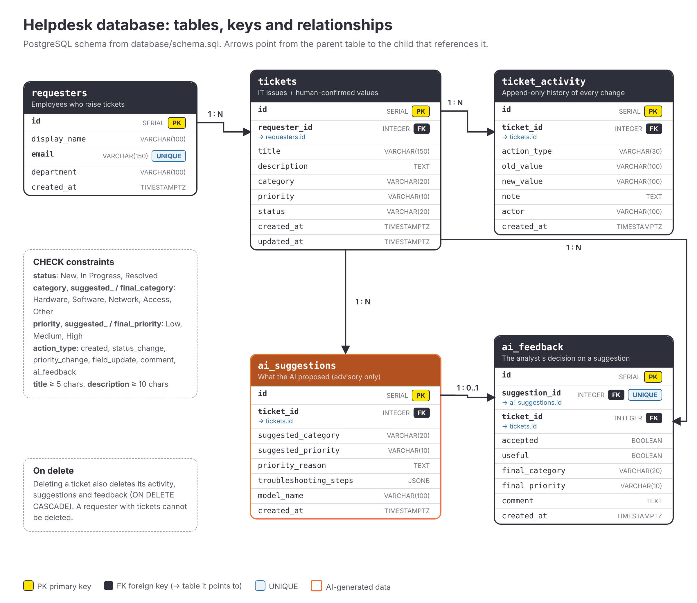

# AI-Powered Employee Helpdesk

An internal IT helpdesk where employees raise support tickets, support staff manage them through a controlled workflow, and an AI model suggests a category, a priority and first troubleshooting steps for each ticket.

**The AI is advisory only.** Its suggestions are stored separately from the ticket, support staff accept or correct every suggestion, and the AI has no way to change, assign or close a ticket on its own.

Built for the EY Training Capstone Assessment by a team of three - Piyush, Rajnish and Prakriti.

| Layer | Technology |
|---|---|
| Frontend | React (Vite) |
| Backend | Python, FastAPI, Pydantic v2, SQLAlchemy 2 |
| Database | PostgreSQL 16, managed with pgAdmin 4 |
| AI | OpenRouter free model through the OpenAI-compatible chat API (switchable to a local Ollama model) |
| Testing | pytest with FastAPI TestClient and an in-memory SQLite test database |

---

## Contents

1. [Features](#features)
2. [Architecture](#architecture)
3. [How the code is connected](#how-the-code-is-connected)
4. [State between components](#state-between-components)
5. [Workflow](#workflow)
6. [Database](#database)
7. [AI integration](#ai-integration)
8. [API reference](#api-reference)
9. [HTTP status codes](#http-status-codes)
10. [Project structure](#project-structure)
11. [Setup](#setup)
12. [Running the backend](#running-the-backend)
13. [Testing](#testing)
14. [Demonstration scenarios](#demonstration-scenarios)
15. [Security and logging](#security-and-logging)
16. [Troubleshooting](#troubleshooting)
17. [Documentation and evidence](#documentation-and-evidence)
18. [Team](#team)

---

## Features

**Employees can:**
- raise a ticket with a title, description and optional category, and see clear validation messages when something is missing;
- see their own tickets with ID, category, priority, status and creation date;
- open a ticket to see its description, progress history and support comments.

**Support analysts can:**
- view all tickets and filter them by status, category or priority;
- change status (New, In Progress, Resolved) under controlled transition rules, set priority, edit fields and add notes;
- ask the AI for a suggested category, priority with a reason, and troubleshooting steps;
- accept or correct each AI suggestion and mark it useful or not useful;
- see ticket counts by status, priority and category on a dashboard.

**The system guarantees that:**
- every change is kept in a permanent history;
- AI suggestions are stored apart from the human-confirmed values;
- ticket work continues normally when the AI is unavailable;
- all data survives a backend restart.

---

## Architecture



The application has three layers plus an optional AI provider:

| Component | Responsibility | Talks to |
|---|---|---|
| **React frontend** | Employee and support screens. Holds UI state only, and shows whatever the API returns | FastAPI only, over REST and JSON |
| **FastAPI backend** | Owns every business rule: validation, status transitions, history, AI orchestration, feedback, dashboard queries | PostgreSQL and OpenRouter |
| **PostgreSQL** | Single source of truth for all records | FastAPI only |
| **OpenRouter** | Returns an advisory JSON suggestion for a ticket | FastAPI only, and only when support asks |

Architecture rules:

1. PostgreSQL is the only source of truth. The frontend never keeps its own copy of ticket data.
2. Only FastAPI talks to the database and the AI model. The API key stays in the backend `.env` and never reaches the browser.
3. The AI path is optional. If OpenRouter fails, every ticket operation keeps working.
4. The AI service returns data only. It has no code path that can change a ticket.

---

## How the code is connected

```
backend/.env                     settings and secrets (never committed)
    ↓  read by
app/config.py   → settings       one shared settings object
    ↓  used by                     ↓  used by
app/db.py       → get_db()       app/services/ai_service.py → analyse_ticket()
    ↓  used by every router        ↓  used only by routers/ai.py
app/routers/*.py → API endpoints, one file per group of URLs
    ↓  registered in
app/main.py     → app            the FastAPI application
    ↓  started by
uvicorn app.main:app --reload
```

| File | Role |
|---|---|
| `app/config.py` | Reads `backend/.env` into a `settings` object. The only file that reads environment variables |
| `app/db.py` | **The only place the app connects to PostgreSQL.** Creates the engine from `DATABASE_URL`, and `get_db()` gives each request its own session and always closes it |
| `app/models.py` | SQLAlchemy classes mapped to the five tables |
| `app/schemas.py` | Pydantic models that validate every request and shape every response |
| `app/services/workflow.py` | The allowed status transitions, defined once |
| `app/services/ai_service.py` | **The only place the app talks to the AI model.** Builds the prompt, calls OpenRouter, validates the reply |
| `app/routers/*.py` | Endpoints. Each one gets a database session with `Depends(get_db)` |
| `app/main.py` | Creates the app, adds CORS for the React origin, registers all five routers, and defines `/` and `/api/health` |

**Example request path:** `POST /api/tickets/1/ai-analysis`

1. `main.py` routes the request to `run_ai_analysis` in `routers/ai.py`.
2. FastAPI calls `get_db()`, which opens a PostgreSQL session.
3. The ticket is loaded with `db.get(Ticket, 1)`, or the API returns 404.
4. `analyse_ticket()` sends the title and description to OpenRouter and validates the JSON reply.
5. The suggestion is saved with `db.add()` and `db.commit()` into `ai_suggestions`. The ticket itself is not touched.
6. The response is shaped by `AISuggestionOut` and returned with 201, and the session is closed.

---

## State between components



| Component | Holds | Never holds | Lifetime |
|---|---|---|---|
| React | UI state: role, selected requester, filters, form values and errors, loading flags, the last API responses | API keys; data the API did not return | Until the page is refreshed |
| FastAPI | Per-request state: database session, validated request model, settings, transition rules | Ticket data between requests; secrets in logs or responses | One request (stateless) |
| PostgreSQL | All permanent data | Secrets | Permanent, survives restarts |
| OpenRouter | Nothing about the application | Requester names, emails, database access | One call |

---

## Workflow

### Ticket status lifecycle



| From | To | Allowed | Result |
|---|---|---|---|
| (new ticket) | New | Yes | 201 Created |
| New | In Progress | Yes | 200 OK, history row added |
| In Progress | Resolved | Yes | 200 OK, history row added |
| Resolved | In Progress | Yes (reopen) | 200 OK, history row added |
| New | Resolved | No | 409 Conflict |
| Any | New | No | 409 Conflict |
| Any | Same status | No | 409 Conflict |

The rules live in one place, `services/workflow.py`, and only support staff change status. Every change writes a `ticket_activity` row with the old value, the new value, who made the change and when.

### AI suggestion lifecycle



The AI runs only when a support analyst requests analysis for a ticket. The state of a ticket's AI suggestion is worked out from the data, so no separate status column is needed:

| State | How it is known |
|---|---|
| Not analysed | No row in `ai_suggestions` for the ticket |
| Suggested | The latest suggestion has no `ai_feedback` row |
| Reviewed | The latest suggestion has an `ai_feedback` row |
| Failed | The analysis request returned 502, 503 or 504. Nothing is stored, and the analyst can try again |

### End-to-end flow



1. **Employee raises a ticket.** `POST /api/tickets/` validates the input, saves the ticket with status New, and records a `created` history entry.
2. **Support requests AI analysis.** `POST /api/tickets/{id}/ai-analysis` sends only the title and description to OpenRouter, validates the reply, and saves it in `ai_suggestions`.
3. **Support accepts or corrects.** `POST /api/ai-suggestions/{id}/feedback` saves the decision, copies the final category and priority onto the ticket, and records an `ai_feedback` history entry, all in one transaction.
4. **Support resolves the ticket.** `PATCH /api/tickets/{id}/status` checks the transition, updates the status and records the change.

---

## Database



### Tables

| Table | Primary key | Foreign keys | What it stores |
|---|---|---|---|
| `requesters` | `id` | none | Employees who raise tickets: name, unique email, department |
| `tickets` | `id` | `requester_id` → `requesters.id` | Each issue, with the **human-confirmed** category, priority and status |
| `ticket_activity` | `id` | `ticket_id` → `tickets.id` | Append-only history: creation, status and priority changes, field edits, notes and AI feedback events |
| `ai_suggestions` | `id` | `ticket_id` → `tickets.id` | The AI's proposal: category, priority, reason, troubleshooting steps (JSONB) and the model used |
| `ai_feedback` | `id` | `suggestion_id` → `ai_suggestions.id` (UNIQUE), `ticket_id` → `tickets.id` | The analyst's decision: accepted or corrected, useful or not, and the final values |

### Relationships

| Parent | Child | Type |
|---|---|---|
| `requesters` | `tickets` | 1 : N, one employee raises many tickets |
| `tickets` | `ticket_activity` | 1 : N, one ticket has many history entries |
| `tickets` | `ai_suggestions` | 1 : N, a ticket can be analysed more than once |
| `ai_suggestions` | `ai_feedback` | 1 : 0..1, each suggestion gets at most one review |
| `tickets` | `ai_feedback` | 1 : N |

Deleting a ticket also deletes its activity, suggestions and feedback (`ON DELETE CASCADE`). A requester who still has tickets cannot be deleted.

### Constraints

- **Status:** `New`, `In Progress`, `Resolved`
- **Category** (confirmed, suggested and final): `Hardware`, `Software`, `Network`, `Access`, `Other`
- **Priority** (confirmed, suggested and final): `Low`, `Medium`, `High`
- **Action type:** `created`, `status_change`, `priority_change`, `field_update`, `comment`, `ai_feedback`
- **Length:** a title needs at least 5 characters, and a description at least 10
- **Indexes:** on `tickets.requester_id`, `tickets.status`, `ticket_activity.ticket_id` and `ai_suggestions.ticket_id`

The constraints are enforced by PostgreSQL itself, so invalid data is rejected even if it bypasses the API.

The full column-by-column description of every table is in [docs/database.md](docs/database.md).

### Scripts

| File | Purpose |
|---|---|
| `database/schema.sql` | Drops and recreates the 5 tables with keys, constraints and indexes |
| `database/seed.sql` | Loads fictional test data: 5 employees, 8 tickets across all statuses, their history, and one corrected AI suggestion. It can be run again at any time and resets the IDs to 1 |
| `database/queries.sql` | The join and aggregate queries for the assessment |

Ticket 1 is the wireless keyboard case (Scenario 01) and ticket 2 is the department-wide shared drive outage (Scenario 02).

### Assessment queries (`database/queries.sql`)

| Query | Type | Shows |
|---|---|---|
| Q1 | `JOIN` + `LEFT JOIN LATERAL` | Every ticket with its requester's details and its latest status change |
| Q2 | `COUNT` + `GROUP BY` | Ticket count per status |
| Q3 | `COUNT` + `GROUP BY` | Ticket count per priority, with unset priorities shown as `Not set` |
| Q4 | `JOIN` + `LEFT JOIN` | Each AI suggestion next to the analyst's final decision |

In Q1, the `LATERAL` subquery runs once per ticket and picks its newest history row. The `LEFT` joins in Q1 and Q4 keep rows that have no match yet, such as suggestions that haven't been reviewed.

---

## AI integration

### How a suggestion is produced

1. The analyst requests analysis: `POST /api/tickets/{id}/ai-analysis`.
2. `ai_service.py` builds the prompt. The rules are in the system message, and the ticket's title and description go in the user message inside `<ticket>` tags. Requester names and emails are never sent.
3. The service calls `{OPENROUTER_BASE_URL}/chat/completions` with the configured model, a low temperature (0.2) for consistent answers, and a timeout of `AI_TIMEOUT_SECONDS`.
4. The reply must be this JSON object:
   ```json
   {
     "category": "Hardware | Software | Network | Access | Other",
     "priority": "Low | Medium | High",
     "priority_reason": "one or two sentences on business impact",
     "troubleshooting_steps": ["step 1", "step 2", "step 3"]
   }
   ```
5. Code fences or extra text around the JSON are stripped. The result is then validated with Pydantic: only the allowed categories and priorities are accepted, the reason must be 1 to 300 characters, and there must be 1 to 6 steps of up to 200 characters each.
6. A valid result is saved in `ai_suggestions`. The ticket is not changed.
7. The analyst accepts or corrects it through the feedback endpoint. Only then are the ticket's category and priority updated.

### Priority guidance given to the model

| Priority | Business impact |
|---|---|
| High | Many people or a whole team blocked, or business-critical work stopped |
| Medium | One person blocked from important work, or several people slowed down |
| Low | Minor issue, a workaround exists, or only one person is inconvenienced |

### Prompt-injection protection

- The rules are in the system message. The ticket text is labelled as untrusted user data and wrapped in `<ticket>` tags.
- Any `<ticket>` tags typed by an employee are removed, so their text cannot escape the block.
- The AI service has no access to the database or the ticket endpoints. Even a successful injection cannot change a ticket.

### Failure handling

`ai_service.py` raises plain Python errors, and `routers/ai.py` turns each one into an HTTP response:

| Situation | Error raised | API response | Data saved |
|---|---|---|---|
| `AI_ENABLED=false`, connection failure, invalid key (401), unknown model (404), rate limit (429) | `AIUnavailableError` | **503** "AI service is unavailable. You can continue managing the ticket manually." | Nothing |
| No reply within `AI_TIMEOUT_SECONDS` | `AITimeoutError` | **504** "AI analysis timed out." | Nothing |
| Reply is not valid JSON, or uses values outside the allowed lists | `AIInvalidOutputError` | **502** "AI returned an invalid response." | Nothing |

All other endpoints keep working in every case.

### Model choice

- **Provider:** OpenRouter, free tier
- **Model used in testing:** `nvidia/nemotron-3.5-super-vl:free`
- **Backup model:** `<add a second free model ID>`

Free models are rate limited and can be withdrawn. If the model starts returning 503 or invalid output, set `OPENROUTER_MODEL` to the backup model and restart the backend.

### Switching to a local Ollama model

The assessment brief recommends a locally runnable model. Because the service uses the OpenAI-compatible request format, switching to Ollama only needs a `.env` change:

```
ollama pull qwen2.5:3b
```

```
OPENROUTER_BASE_URL=http://localhost:11434/v1
OPENROUTER_MODEL=qwen2.5:3b
OPENROUTER_API_KEY=
```

No code changes are needed.

---

## API reference

All endpoints are under `/api`. Interactive documentation, with every request and response schema, is at **http://localhost:8000/docs**.

### Health

| Method | Endpoint | Purpose | Success |
|---|---|---|---|
| GET | `/` | Basic API information | 200 |
| GET | `/api/health` | Health check | 200 |

### Requesters (`routers/requesters.py`)

| Method | Endpoint | Purpose | Responses |
|---|---|---|---|
| POST | `/api/requesters/` | Create an employee | 201, 409 duplicate email, 422 |
| GET | `/api/requesters/` | List employees | 200 |
| GET | `/api/requesters/{id}` | One employee | 200, 404 |

### Tickets (`routers/tickets.py`)

| Method | Endpoint | Purpose | Responses |
|---|---|---|---|
| POST | `/api/tickets/` | Create a ticket | 201, 400, 404 unknown requester, 422 |
| GET | `/api/tickets/` | List tickets. Optional filters: `requester_id`, `status_filter`, `category`, `priority` | 200, 400 |
| GET | `/api/tickets/{id}` | One ticket | 200, 404 |
| PATCH | `/api/tickets/{id}` | Update title, description or category | 200, 400, 404, 422 |
| GET | `/api/tickets/{id}/history` | The ticket's activity history | 200, 404 |
| PATCH | `/api/tickets/{id}/status` | Change status | 200, 400, 404, 409 |
| PATCH | `/api/tickets/{id}/priority` | Set priority | 200, 400, 404 |
| POST | `/api/tickets/{id}/comments` | Add a support note | 201, 404, 422 |

### AI (`routers/ai.py`)

| Method | Endpoint | Purpose | Responses |
|---|---|---|---|
| POST | `/api/tickets/{id}/ai-analysis` | Run AI analysis and store the suggestion | 201, 404, 502, 503, 504 |
| GET | `/api/tickets/{id}/ai-suggestions` | All suggestions for a ticket, newest first | 200, 404 |

### AI feedback (`routers/feedback.py`)

| Method | Endpoint | Purpose | Responses |
|---|---|---|---|
| POST | `/api/ai-suggestions/{id}/feedback` | Accept or correct a suggestion | 201, 404, 409 already reviewed, 422 |

### Dashboard (`routers/dashboard.py`)

| Method | Endpoint | Purpose | Responses |
|---|---|---|---|
| GET | `/api/dashboard/summary` | Total tickets and counts by status, priority and category | 200 |

### Example requests

Create a ticket:

```json
POST /api/tickets/
{"requester_id": 1, "title": "Monitor flickering", "description": "My second monitor flickers every few seconds."}
```

Change status:

```json
PATCH /api/tickets/9/status
{"status": "In Progress", "note": "Checking the cable"}
```

Add a support note:

```json
POST /api/tickets/9/comments
{"note": "Replaced the HDMI cable", "actor": "Support"}
```

Accept or correct an AI suggestion:

```json
POST /api/ai-suggestions/2/feedback
{"accepted": false, "useful": true, "final_category": "Hardware", "final_priority": "Medium", "comment": "Employee cannot type reports"}
```

---

## HTTP status codes

| Code | Meaning | How it is produced |
|---|---|---|
| 200 | OK | Default for successful reads and updates |
| 201 | Created | Set with `status_code=201` on each endpoint that creates a record |
| 400 | Bad Request | Raised by manual checks for unknown category, status or priority values, or a priority that is already set |
| 404 | Not Found | Raised when a ticket, requester or suggestion does not exist |
| 409 | Conflict | A blocked status transition (`services/workflow.py`), a duplicate requester email, or a second review of the same suggestion |
| 422 | Unprocessable Entity | Returned automatically by FastAPI and Pydantic when a request breaks a schema rule, such as a missing field, a title that's too short, the wrong type or an invalid email |
| 500 | Internal Server Error | A database save failed. The change is rolled back first, so nothing is left half-saved |
| 502, 503, 504 | AI failures | See [Failure handling](#failure-handling) |

Error responses always have the shape `{"detail": "..."}`. For 422, `detail` is a list of field errors.

---

## Project structure

```
helpdesk/
  backend/
    app/
      main.py              FastAPI app, CORS, router registration, health check
      config.py            settings loaded from backend/.env
      db.py                database engine and one session per request
      models.py            SQLAlchemy models (mirror database/schema.sql)
      schemas.py           Pydantic request and response models
      routers/
        tickets.py         ticket CRUD, history, status, priority, comments
        ai.py              AI analysis and suggestions
        feedback.py        accept or correct an AI suggestion
        dashboard.py       summary counts
        requesters.py      employees
      services/
        workflow.py        allowed status transitions
        ai_service.py      prompt, OpenRouter call, reply validation
    tests/
      conftest.py          shared test client with an in-memory SQLite database
      test_tickets.py      ticket and workflow endpoints
      test_workflow.py     status transition rules
      test_ai_service.py   AI service with a fake model
      test_ai_api.py       AI endpoints, including model-unavailable behaviour
    check_ai.py            smoke test that calls the real AI model
    requirements.txt
    .env.example           template for .env (no real secrets)
  frontend/                React application
  database/
    schema.sql             creates the tables
    seed.sql               fictional test data
    queries.sql            join and aggregate queries
  docs/
    diagrams/              architecture, workflow and database diagrams
    screenshots/           test and demo evidence
    database.md            full table and column reference
  .gitignore
  README.md
```

---

## Setup

### Prerequisites

- Python 3.11 or newer
- PostgreSQL 16 and pgAdmin 4 (both come with the Windows PostgreSQL installer)
- Git
- An OpenRouter account and API key: https://openrouter.ai
- Node.js 18 or newer, for the frontend

The commands below are for Windows PowerShell. On macOS or Linux, activate the virtual environment with `source venv/bin/activate` and use `cp` instead of `copy`.

### 1. Get the code

```
git clone https://github.com/Rajnishmaurya/helpdesk.git
cd helpdesk
```

### 2. Install backend packages

```
cd backend
python -m venv venv
venv\Scripts\activate
pip install -r requirements.txt
```

If you use PyCharm, set the project interpreter to `backend\venv\Scripts\python.exe`, so PyCharm and the terminal use the same packages.

### 3. Create the database

The database is not stored in Git. Each team member builds their own copy from the scripts.

1. Make sure PostgreSQL is running:
   ```
   Get-Service postgresql-x64-16
   ```
   If it shows `Stopped`, run `Start-Service postgresql-x64-16` in PowerShell as administrator.
2. In pgAdmin, right-click **Databases**, choose **Create > Database**, and name it `helpdesk` (all lowercase).
3. Select `helpdesk`, then open **Tools > Query Tool**. Check that the tab title says `helpdesk/postgres@PostgreSQL 16`.
4. Open `database/schema.sql` and press **F5**. Notices such as "does not exist, skipping" are normal.
5. Open `database/seed.sql` and press **F5**.
6. Check the result:
   ```sql
   SELECT count(*) FROM tickets;   -- returns 8
   ```

To reset the database at any time, run `schema.sql` and then `seed.sql` again. `schema.sql` drops the tables, so use it on development machines only.

### 4. Create `backend/.env`

```
copy .env.example .env
```

Fill in your own values:

```
DATABASE_URL=postgresql+psycopg://postgres:<your password>@localhost:5432/helpdesk
OPENROUTER_API_KEY=<your OpenRouter key>
OPENROUTER_BASE_URL=https://openrouter.ai/api/v1
OPENROUTER_MODEL=<free model id ending in :free>
AI_TIMEOUT_SECONDS=30
AI_ENABLED=true
LOG_LEVEL=INFO
CORS_ORIGINS=http://localhost:5173
```

| Variable | Purpose |
|---|---|
| `DATABASE_URL` | PostgreSQL connection. Must start with `postgresql+psycopg://` |
| `OPENROUTER_API_KEY` | OpenRouter API key. Leave empty for Ollama |
| `OPENROUTER_BASE_URL` | OpenAI-compatible endpoint of the AI provider |
| `OPENROUTER_MODEL` | Model ID. Free OpenRouter models end in `:free` |
| `AI_TIMEOUT_SECONDS` | Maximum wait for an AI reply before returning 504 |
| `AI_ENABLED` | Set to `false` to switch AI off. Analysis then returns 503 immediately |
| `LOG_LEVEL` | Backend log level, for example `INFO` or `DEBUG` |
| `CORS_ORIGINS` | Frontend origins allowed to call the API |

Things to watch:
- `.env` must be in the `backend` folder, because `config.py` reads it from there.
- If your password contains `@`, `#`, `/` or `:`, URL-encode it. For example, `Admin@123` becomes `Admin%40123`.
- `.env` is listed in `.gitignore` and must never be committed.

---

## Running the backend

From the `backend` folder with the virtual environment active:

```
uvicorn app.main:app --reload
```

| URL | What it is |
|---|---|
| http://localhost:8000/docs | Swagger UI. Try every endpoint without the frontend |
| http://localhost:8000/redoc | Alternative API documentation |
| http://localhost:8000/api/health | Health check |

Run all Python commands from `backend`, and all `git` commands from the repository root.

---

## Testing

### Automated tests

From the `backend` folder:

```
python -m pytest -v
```

The tests use the `client` fixture from `tests/conftest.py`. It replaces the PostgreSQL session with an in-memory SQLite database, so tests never touch your real data. The AI tests replace the HTTP call to OpenRouter with a fake, so no API key or internet connection is needed.

| File | What it covers |
|---|---|
| `test_tickets.py` | Ticket creation (201), invalid input (422 and 400), unknown requester and ticket (404), listing and filters, updates, history, valid and blocked status transitions (200 and 409), priority and comments |
| `test_workflow.py` | Every allowed and blocked status transition, tested directly |
| `test_ai_service.py` | AI service: valid replies, replies in code fences, invalid categories, non-JSON replies, server down, rate limit, timeout, AI disabled, prompt-injection text staying inside `<ticket>` |
| `test_ai_api.py` | AI endpoints: suggestion saved without changing the ticket, 404 for a missing ticket, **503 with the model unavailable while status, priority and listing still work**, 504 and 502, suggestions newest first |

### Real AI smoke test

```
python check_ai.py
```

This sends the Scenario 01 and Scenario 02 tickets to the real model in `.env` and prints the suggestions. Expect Hardware for the keyboard ticket, and High priority for the shared drive outage. It uses your OpenRouter quota, so it is not part of the pytest suite.

### Manual testing in Swagger

Reset the database first, so the IDs below match:

1. `GET /api/health` returns 200.
2. `POST /api/tickets/` with a valid body returns 201 and ticket 9. With `"title": ""` it returns 422.
3. `PATCH /api/tickets/9/status` with `{"status": "Resolved"}` returns 409. With `{"status": "In Progress"}` it returns 200.
4. `POST /api/tickets/1/ai-analysis` returns 201 and suggestion 2. `GET /api/tickets/1` shows the ticket unchanged.
5. `POST /api/ai-suggestions/2/feedback` returns 201, and the same request again returns 409.
6. `GET /api/tickets/1/history` ends with an `ai_feedback` entry.
7. `GET /api/dashboard/summary` returns the counts.

---

## Demonstration scenarios

| Scenario | What must be shown | How to demonstrate |
|---|---|---|
| 01 Routine ticket | A wireless keyboard ticket persists, and the AI suggests a category, priority and actions | Raise the keyboard ticket, then run AI analysis. Expect Hardware with Low or Medium priority |
| 02 Major outage | A department-wide outage gets a high-impact suggestion | Run AI analysis on the shared drive outage. Expect High priority with a business-impact reason |
| 03 Human correction | Corrected values and feedback are stored and visible after refresh | Change the suggested priority, mark it useful or not useful, save, and refresh the ticket and its history |
| 04 AI unavailable | Tickets can be created, listed and updated while the AI is down | Set `OPENROUTER_BASE_URL=http://localhost:9` and restart. Analysis returns 503 while ticket actions still work |
| 05 Invalid request | The validation error from FastAPI is shown | Submit a ticket with an empty title. The API returns 422 with the field error |
| 06 Persistence | Tickets, history, comments and feedback survive a restart | Stop and start the backend, then refresh and reopen a ticket |

The brief requires each scenario to be demonstrated through the application itself. Swagger and pgAdmin screenshots in `docs/screenshots/` are supporting evidence for the backend.

---

## Security and logging

- **Secrets live only in `backend/.env`.** That means the database password and `OPENROUTER_API_KEY`. The file is git-ignored, and `.env.example` contains placeholders only.
- **The API key is used only by the backend.** It is never logged, returned in a response, or sent to the browser.
- **Only the ticket title and description are sent to the AI.** Requester names, emails and ticket status never leave the backend.
- **AI log lines contain no ticket text.** They record the ticket ID, the outcome, the chosen category and priority, and the duration. They never contain ticket text, email addresses or keys.
- **Ticket text is treated as untrusted input.** See [Prompt-injection protection](#prompt-injection-protection).
- **All data is fictional.** Seed and demo data are invented. Do not enter personal or confidential information in tickets, because ticket text is sent to an external AI provider.
- **CORS is restricted** to the origins listed in `CORS_ORIGINS`.

---

## Troubleshooting

| Problem | Cause and fix |
|---|---|
| pgAdmin shows "connection timeout expired" | PostgreSQL is not running. Run `Get-Service postgresql-x64-16`, and if it is stopped, start it from an administrator PowerShell with `Start-Service postgresql-x64-16` |
| `database "helpdesk" does not exist` | The database hasn't been created on this machine, or its name has a capital letter. See [Create the database](#3-create-the-database) |
| `password authentication failed` | Wrong password in `DATABASE_URL`, or a special character that isn't URL-encoded (`@` becomes `%40`) |
| `ModuleNotFoundError: No module named 'app'` | The command was run from the wrong folder. Run Python commands from `backend` |
| Settings seem to be ignored, for example a blank model in `check_ai.py` | `.env` is not in `backend`, or a variable name is misspelled |
| AI analysis always returns 503 | Check `OPENROUTER_API_KEY` and `OPENROUTER_MODEL`. The backend log shows the provider's status: 401 bad key, 404 unknown model, 429 rate limit |
| `check_ai.py` prints INVALID OUTPUT | The model isn't following the JSON format. Switch `OPENROUTER_MODEL` to another free model |
| PyCharm shows missing packages but the terminal works | PyCharm is using a different interpreter. Select `backend\venv\Scripts\python.exe` |
| Tables appear in the wrong database | The Query Tool was opened on another database. Open it from `helpdesk` and check the tab title |

---

## Documentation and evidence

| Location | Contents |
|---|---|
| `docs/diagrams/` | Architecture, state between components, ticket status and AI lifecycles, end-to-end flow, database ERD |
| `docs/database.md` | Every table and column, with keys, rules and meaning |
| `docs/screenshots/` | Swagger, pgAdmin query and test evidence |
| `/docs` on the running backend | Interactive OpenAPI documentation |
| Agile delivery document (PDF in the repository) | Epics, features, user stories, sprint plan, scope and risks |

---

## Team

| Member | Responsibility |
|---|---|
| Person A | Ticket and employee API, dashboard, React frontend |
| Person B | Support workflow (status, priority, comments), AI feedback endpoint, application configuration, logging, test setup |
| Person C | PostgreSQL schema, seed data and queries, database connection and models, AI service and AI endpoints, AI tests, documentation |
