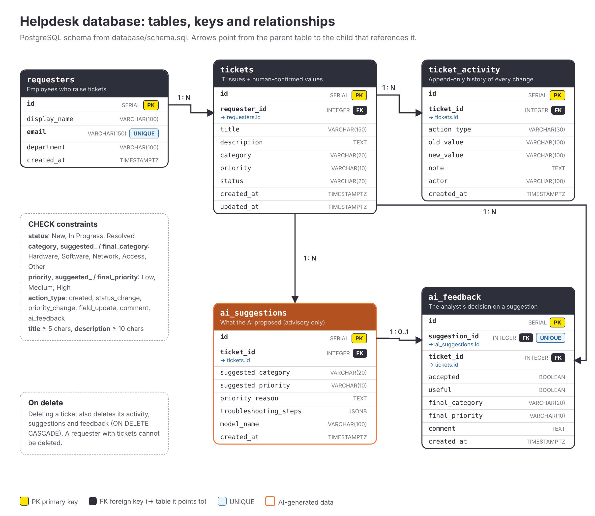

# Database design

PostgreSQL schema for the AI-Powered Employee Helpdesk. The tables are created by `database/schema.sql` and filled with test data by `database/seed.sql`.

## Relationships

| Parent table (primary key) | Child table (foreign key) | Type | Meaning |
|---|---|---|---|
| `requesters.id` | `tickets.requester_id` | 1 : N | One employee can raise many tickets; every ticket belongs to one employee |
| `tickets.id` | `ticket_activity.ticket_id` | 1 : N | One ticket has many history entries |
| `tickets.id` | `ai_suggestions.ticket_id` | 1 : N | One ticket can be analysed by the AI several times |
| `ai_suggestions.id` | `ai_feedback.suggestion_id` | 1 : 0..1 | Each suggestion gets at most one human review (`UNIQUE`) |
| `tickets.id` | `ai_feedback.ticket_id` | 1 : N | Lets feedback be listed per ticket without going through suggestions |

Deleting a ticket also deletes its activity, suggestions and feedback (`ON DELETE CASCADE`). A requester who still has tickets cannot be deleted.

## Tables

### requesters
Employees who raise support tickets.

| Column | Type | Key / rule | What it stores |
|---|---|---|---|
| `id` | SERIAL | PK | Unique employee number, generated automatically |
| `display_name` | VARCHAR(100) | NOT NULL | Employee's name |
| `email` | VARCHAR(150) | NOT NULL, UNIQUE | Contact email; no two employees can share one |
| `department` | VARCHAR(100) | | Employee's department, e.g. Finance |
| `created_at` | TIMESTAMPTZ | default now() | When the employee record was created |

### tickets
Every IT issue raised, with the values **confirmed by support staff**. AI proposals are never written here directly.

| Column | Type | Key / rule | What it stores |
|---|---|---|---|
| `id` | SERIAL | PK | Unique ticket number |
| `requester_id` | INTEGER | FK → `requesters.id`, NOT NULL | Employee who raised the ticket |
| `title` | VARCHAR(150) | NOT NULL, at least 5 characters | Short summary of the issue |
| `description` | TEXT | NOT NULL, at least 10 characters | Full description from the employee |
| `category` | VARCHAR(20) | CHECK: Hardware, Software, Network, Access, Other (or NULL) | Confirmed category; NULL until set |
| `priority` | VARCHAR(10) | CHECK: Low, Medium, High (or NULL) | Confirmed priority; NULL until set |
| `status` | VARCHAR(20) | CHECK: New, In Progress, Resolved; default New | Current workflow status |
| `created_at` | TIMESTAMPTZ | default now() | When the ticket was raised |
| `updated_at` | TIMESTAMPTZ | default now() | When the ticket last changed |

### ticket_activity
Append-only history of everything that happens to a ticket. Rows are added, never edited, so earlier status changes are always preserved.

| Column | Type | Key / rule | What it stores |
|---|---|---|---|
| `id` | SERIAL | PK | Unique history entry number |
| `ticket_id` | INTEGER | FK → `tickets.id`, NOT NULL | Ticket this entry belongs to |
| `action_type` | VARCHAR(30) | CHECK: created, status_change, priority_change, field_update, comment, ai_feedback | What kind of event happened |
| `old_value` | VARCHAR(100) | | Value before the change, e.g. `New` |
| `new_value` | VARCHAR(100) | | Value after the change, e.g. `In Progress` |
| `note` | TEXT | | Support comment or explanation |
| `actor` | VARCHAR(100) | NOT NULL | Who made the change, e.g. `Support` or the employee's name |
| `created_at` | TIMESTAMPTZ | default now() | When it happened |

### ai_suggestions
What the AI model proposed for a ticket. Advisory only: stored separately so it can never overwrite the confirmed ticket values.

| Column | Type | Key / rule | What it stores |
|---|---|---|---|
| `id` | SERIAL | PK | Unique suggestion number |
| `ticket_id` | INTEGER | FK → `tickets.id`, NOT NULL | Ticket that was analysed |
| `suggested_category` | VARCHAR(20) | NOT NULL, same CHECK list as `tickets.category` | Category the AI proposed |
| `suggested_priority` | VARCHAR(10) | NOT NULL, same CHECK list as `tickets.priority` | Priority the AI proposed |
| `priority_reason` | TEXT | NOT NULL | AI's short explanation of the business impact |
| `troubleshooting_steps` | JSONB | NOT NULL | List of first troubleshooting steps for support staff |
| `model_name` | VARCHAR(100) | NOT NULL | Which model produced the suggestion |
| `created_at` | TIMESTAMPTZ | default now() | When the analysis ran |

### ai_feedback
The support analyst's decision on an AI suggestion: accepted or corrected, useful or not, and the final values used.

| Column | Type | Key / rule | What it stores |
|---|---|---|---|
| `id` | SERIAL | PK | Unique feedback number |
| `suggestion_id` | INTEGER | FK → `ai_suggestions.id`, NOT NULL, UNIQUE | Suggestion being reviewed; only one review each |
| `ticket_id` | INTEGER | FK → `tickets.id`, NOT NULL | Ticket the suggestion was for |
| `accepted` | BOOLEAN | NOT NULL | `true` = AI values accepted as they were; `false` = corrected |
| `useful` | BOOLEAN | NOT NULL | Analyst's rating of the suggestion |
| `final_category` | VARCHAR(20) | NOT NULL, same CHECK list | Category the analyst confirmed |
| `final_priority` | VARCHAR(10) | NOT NULL, same CHECK list | Priority the analyst confirmed |
| `comment` | TEXT | | Optional reason for the decision |
| `created_at` | TIMESTAMPTZ | default now() | When the decision was recorded |

## How the AI and human values stay separate

1. The AI's proposal goes into `ai_suggestions` only.
2. The analyst accepts or corrects it; the decision goes into `ai_feedback`.
3. Only then are the analyst's final values copied into `tickets.category` and `tickets.priority`, and an `ai_feedback` entry is added to `ticket_activity`.

So for any ticket you can see what the AI suggested, what the human decided, and when.
